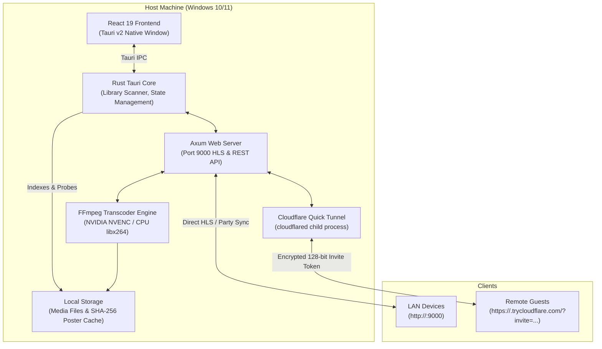

# Monolith

A modern, local-first media streaming desktop application and LAN server built with **Rust (Tauri v2 + Axum)** and **React 19 (TypeScript + Vite)**.

Monolith transforms your local video library into a private, high-performance streaming service. It indexes video collections directly from disk without external metadata scrapers or cloud dependencies, transcodes on-the-fly using NVIDIA NVENC hardware acceleration, and serves adaptive HLS video over your home network. With built-in encrypted Watch Party synchronization and instant Cloudflare Quick Tunnels, you can stream videos with friends anywhere in seconds—with zero port forwarding.

---

## Key Features

- **Hardware-Accelerated HLS Streaming (Port 9000)**
  - Real-time transcoding pipeline powered by FFmpeg serving HTTP Live Streaming (`.m3u8` playlists and dynamic 2-second `.ts` segments) over `0.0.0.0:9000`.
  - **NVIDIA NVENC CUDA acceleration** (`-hwaccel cuda -c:v h264_nvenc`) for smooth playback with minimal CPU overhead.
  - Automatic fallback to high-efficiency CPU transcoding (`-c:v libx264 -preset veryfast`) when dedicated GPU acceleration is unavailable.

- **Encrypted Watch Party Synchronization**
  - Synchronized, multi-user playback (Play, Pause, Seek) for friends and family across LAN or remote internet connections.
  - Real-time shared state engine coordinates active media, playback timestamp, and audio/subtitle tracks with low latency.

- **Cloudflare Quick Tunnel Integration**
  - Instant, zero-configuration remote access without manual port forwarding, dynamic DNS, or router configuration.
  - Powered by ephemeral Cloudflare Quick Tunnels (`cloudflared`) with alternative SSH TLS fallbacks.
  - Protected by cryptographic **128-bit secret invite tokens** (`?invite=<token>`) to prevent unauthorized scanning.

- **Kill Invite Link (Session Reset)**
  - Instant one-click panic kill switch in the UI that immediately terminates active remote tunnel child processes and rotates the 128-bit invite token, instantly revoking public access and resetting the session.

- **Instant Directory Indexing & SHA-256 Poster Caching**
  - Multi-threaded recursive directory walker supporting `.mkv`, `.mp4`, `.webm`, and `.avi` containers with Windows long-path (`\\?\`) support and symlink cycle protection.
  - Deep stream inspection with `ffprobe` (resolution, duration, codecs, audio channels, and subtitle streams).
  - High-speed poster extraction and video-frame thumbnailing, persistently cached by SHA-256 file hash to `%LOCALAPPDATA%\Monolith\cache\posters`.

- **Live Audio Track Switching & Subtitle Customization**
  - Seamlessly switch between multi-language audio streams on the fly without resetting playback position.
  - On-demand extraction and conversion of embedded subtitle tracks to browser-ready WebVTT (`subs.vtt`) with customizable styling.

- **Refined Dark-Mode Media Interface**
  - Sleek, modern dark-mode interface built with React 19, responsive grid layouts, and smooth transition animations.
  - Intuitive directory-based navigation with folder breadcrumbs and search.
  - Granular, per-folder and per-video watch progress tracking to effortlessly pick up where you left off.

---

## System Architecture



---

## Prerequisites

Before building or running Monolith on Windows, ensure the following tools are installed:

| Requirement | Recommended Version | Installation Command / Link |
| :--- | :--- | :--- |
| **Operating System** | Windows 10 / 11 (64-bit) | Includes Microsoft Edge WebView2 runtime |
| **Rust Toolchain** | Stable (`stable-x86_64-pc-windows-msvc`) | [rustup.rs](https://rustup.rs/) |
| **Node.js** | Node.js 20+ (LTS) & npm | [nodejs.org](https://nodejs.org/) |
| **FFmpeg & FFprobe** | Latest release (added to `PATH`) | `winget install --id Gyan.FFmpeg -e` |
| **Cloudflared** *(Optional)* | For remote Quick Tunnel sharing | `winget install --id Cloudflare.cloudflared` |

> [!TIP]
> After installing FFmpeg and Cloudflared via `winget`, restart your terminal session to ensure the updated `PATH` environment variables are loaded.

---

## Building & Running

### 1. Build the Frontend SPA

Navigate to the `frontend` directory, install dependencies, and compile the production client:

```powershell
cd frontend
npm install
npm run build
cd ..
```

### 2. Build the Standalone Release Executable

Compile the Rust backend and bundle the Tauri desktop binary:

```powershell
cargo build --release
```

The optimized standalone binary will be created at:
```text
target/release/monolith.exe
```

### 3. Run in Development Mode

To start the desktop host with hot-reloading:

```powershell
cargo run
```

When Monolith starts:
- **Desktop Application**: The native host window opens ready for browsing and playback.
- **LAN Web Streaming**: Devices connected to your local network can access the player at:
  ```text
  http://<YOUR_HOST_LOCAL_IP>:9000
  ```
- **Remote Sharing**: Start a Cloudflare Quick Tunnel from the header controls to generate a public invite link with an embedded 128-bit security token.

---

## Remote Sharing & Kill Link Workflow

1. **Start Tunnel**: In the top navigation bar, toggle the remote sharing switch. Monolith invokes `cloudflared` to establish an edge tunnel and attaches a cryptographically random 128-bit UUID token (`?invite=<token>`).
2. **Share Invite**: Copy the generated HTTPS link and send it to your guests. Unauthenticated requests lacking the correct token are rejected.
3. **Watch Party**: Synchronized playback allows all participants to control the stream simultaneously.
4. **Kill Invite Link**: Clicking **Kill Link** immediately terminates the tunnel process, clears the public URL, and rotates the security token to prevent any further access from that link.

---

## Technology Stack

- **Desktop Framework**: [Tauri v2](https://v2.tauri.app/) (Rust window manager & system shell integration)
- **Embedded Web Server**: [Axum](https://github.com/tokio-rs/axum) 0.7 & [Tokio](https://tokio.rs/) async runtime
- **Media Pipeline**: [FFmpeg](https://ffmpeg.org/) (NVIDIA NVENC CUDA acceleration, `libx264` fallback, and `ffprobe` metadata extraction)
- **Frontend SPA**: [React 19](https://react.dev/), [TypeScript](https://www.typescriptlang.org/), [Vite](https://vite.dev/), and [Hls.js](https://github.com/video-dev/hls.js)
- **Edge Tunnels**: [Cloudflare Quick Tunnels](https://developers.cloudflare.com/cloudflare-one/connections/connect-networks/) via `cloudflared`

---

## License

This project is licensed under the [MIT License](LICENSE).
